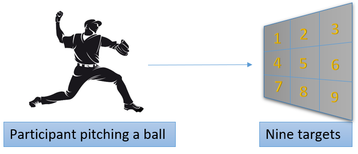

# Intention prediction 

An introduction to intention prediction scenario and data set.


## Experiment scenario

<p align="center">

</p>

The experiment is about a human participant pitching a ball toward a robot (represented by a target area in the figure). The target area is divided into 9 grids which represent the 9 targets that the ball can hit. We expect the robot to be able to predict the intention of the participant (i.e., which of the nine targets the participant is pitching the ball to). 


## Data set

A data set of human intentions behind human actions. This data set is built from multiple human priticipants. The dataset contains RGB images, RGB-D images, skeleton data, and optical flow of human actions.

The data set is free to use for non-commercial purposes.

The dataset is hosted on [Hugging Face](https://huggingface.co/datasets/fantasylsc/intention-prediction) (about 27 GB). Its files are organized into `RGB_images`, `RGB-D_images`, `Skeleton_data`, and `Optical_flow` folders and provided as ZIP archives.

- Install the Hugging Face Hub client: `pip install -U huggingface_hub`
- Download the full dataset:

  ```python
  from huggingface_hub import snapshot_download

  dataset_dir = snapshot_download(
      repo_id="fantasylsc/intention-prediction",
      repo_type="dataset",
      local_dir="data/intention-prediction",
  )
  print(dataset_dir)
  ```

  This downloads all files. To download only one modality, pass `allow_patterns=["RGB_images/*"]` to `snapshot_download` (replace `RGB_images` with `RGB-D_images`, `Skeleton_data`, or `Optical_flow`). Extract the downloaded ZIP archives before using them with the scripts below.

If this data set is useful for your research, please refer to our paper: 

Shengchao Li, Lin Zhang, and Xiumin Diao - [Improving Human Intention Prediction Using Data Augmentation](https://ieeexplore.ieee.org/document/8525781/keywords#keywords)
  ([BibTeX](https://github.com/fantasylsc/Intention_Prediction/blob/master/Bib/LiZD18.bib))

## Others
1. data_acquire: capture 3 sec video by Kinect V2 under Matlab and save the data.

2. dataset_utils:
- `travaltes_slicing.py` slices dataset to train/validation/test by proportion of 6/2/2.
- `create_pitch_tf_record.py` create tfrecord shards.

3. `pitch2d_main.py` training and evaluation.
